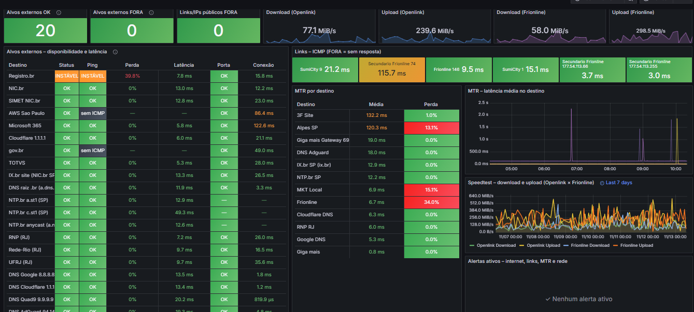
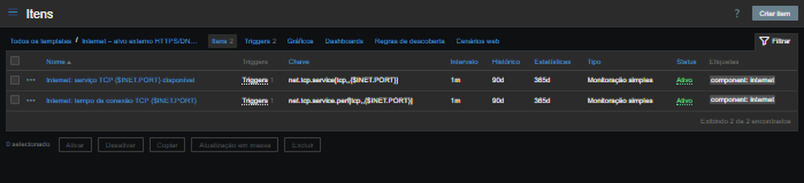
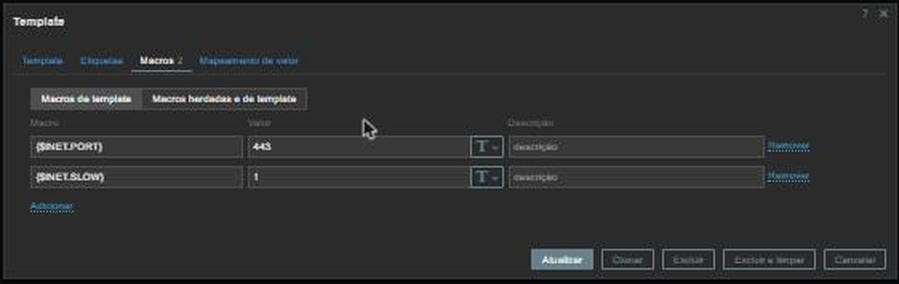

# Rede externa – Internet, IX.br, links e MTR - Grafana e Zabbix.




## Por que foi criada

Quando "a internet está lenta" ou "o e-mail não abre", a primeira pergunta é **onde está o problema**: no link da operadora, na rota até um serviço ou no próprio serviço. Sem medição, a TI só descobre testando na hora, depois da reclamação. Esta dashboard mede continuamente, a partir da rede da empresa, os dois links de internet e os destinos externos que importam para o negócio, e mostra a resposta em uma tela.

## Problemas que resolve

| Pergunta | Onde responde |
|---|---|
| Algum link de internet caiu? | Card *Links/IPs públicos FORA* e *Links – ICMP* (Openlink/SumiCity e Frionline, principal e secundário) |
| Os links entregam a velocidade contratada? | Cards de download/upload e gráfico *Speedtest* (7 dias) dos dois links |
| Um serviço externo está fora ou só a internet está lenta? | Tabela *Alvos externos*: Status, ping, perda, latência e porta do serviço de 21 destinos (Microsoft 365, TOTVS, gov.br, AWS, NIC.br, IX.br, DNS públicos, NTP, RNP, universidades) |
| O DNS e a hora estão funcionando? | Linhas de DNS públicos (Google, Cloudflare, Quad9, AdGuard, raiz .br) e NTP.br |
| Onde na rota está a perda ou a lentidão? | Tabela *MTR por destino* e gráfico de latência: perda, latência média/pior, variação e nº de saltos até 12 destinos |
| O que está alertando agora? | *Alertas ativos* de internet, links, MTR e rede |

**Status de um destino = OK só quando o ping E a porta do serviço respondem.** Ping OK com porta FORA significa que o servidor existe na rede, mas o serviço (HTTPS 443, DNS 53) não atende — foi o caso do Microsoft 365 em 13/11/2026.

**Grafana Labs** https://grafana.com/orgs/marcusronney/dashboards/

## Fontes de dados

| Painéis | Grupo no Zabbix | Como é coletado | Template |
|---|---|---|---|
| Alvos externos (cards OK/FORA e tabela) | `INTERNET EXTERNA` (17 hosts, um por destino; os DNS públicos ficam no host *Internet - Resolucao DNS*) | Ping ICMP e checagem TCP feitos **pelo próprio servidor Zabbix** (itens *simple check*, sem agente) | *Template Module ICMP Ping* (oficial) + **Internet – alvo externo HTTPS/DNS** |
| Links (cards e ICMP) | `net` (hosts `Link…` e `Google`, 8 IPs) | Ping ICMP pelo Zabbix | *Template Module ICMP Ping* |
| MTR | `Monitoramento MTR` (12 hosts) | Script externo `mtr_json.sh` no servidor Zabbix (pasta *ExternalScripts*), a cada `{$MTR.INTERVAL}` | **Template MTR - Analise de Pacotes de Rede** |
| Speedtest | hosts `Speed_test` (Openlink) e `Speed_test_Frionline` | Item *trapper* `speedtestX`: um script de speedtest em cada link envia o JSON com `zabbix_sender`; o Zabbix separa em download, upload, latência, perda e provedor | **Template - SpeedTest** |
| Alertas ativos | grupos acima + `REDE` | Triggers dos templates | — |

### Template "Internet – alvo externo HTTPS/DNS"



| Item | Chave | Alerta |
|---|---|---|
| Serviço TCP disponível | `net.tcp.service[tcp,,{$INET.PORT}]` | `{HOST.NAME}: serviço {$INET.PORT} inacessível` (média) — sem resposta por 5 min |
| Tempo de conexão TCP | `net.tcp.service.perf[tcp,,{$INET.PORT}]` | `{HOST.NAME}: conexão lenta` (aviso) — média de 15 min acima de `{$INET.SLOW}` |

Macros: `{$INET.PORT}` = 443 (53 nos DNS) · `{$INET.SLOW}` = 1 s.

### Template "MTR - Analise de Pacotes de Rede"

Item mestre `mtr_json.sh["{$MTR.TARGET}","{$MTR.CYCLES}"]` → itens dependentes `mtr.destination.avg/best/worst/loss/stdev/host`, `mtr.hops`, `mtr.hop.firstpersistentloss`. Alertas de latência (aviso `{$MTR.RTT.WARN}` = 80 ms, crítico `{$MTR.RTT.HIGH}` = 150 ms), perda (aviso 2%, crítico 5%), pior latência e quantidade de saltos fora de `{$MTR.HOPS.MIN}`–`{$MTR.HOPS.MAX}` (10–14). Cada host define `{$MTR.TARGET}`.




## Como importar em outro ambiente

1. Zabbix → **Data collection → Templates → Import**: `templates/*.yaml`. Depois **Hosts → Import**: `hosts/hosts-rede-externa.yaml` (39 hosts, já vinculados aos templates e grupos).
2. No servidor Zabbix: instalar `mtr` e copiar `mtr_json.sh` para a pasta `ExternalScripts` (o script não está neste pacote — copiar de `/usr/lib/zabbix/externalscripts/` do servidor atual).
3. Speedtest: em uma máquina atrás de cada link, agendar o script de speedtest que envia `speedtestX` com `zabbix_sender` para o host correspondente (não está neste pacote). Exige a porta **10051** do Zabbix liberada.
4. Grafana → **Dashboards → New → Import**: `dashboard/rede-externa-internet-ixbr-links-mtr-portavel.json`, escolhendo o datasource Zabbix. Neste mesmo Grafana, use o arquivo sem `-portavel`.


## Arquivos

| Arquivo | Conteúdo |
|---|---|
| `dashboard/rede-externa-internet-ixbr-links-mtr.json` | Export da dashboard deste Grafana |
| `dashboard/...-portavel.json` | Mesma dashboard com datasource `${DS_ZABBIX}` |
| `templates/internet-alvo-externo-https-dns.yaml` | Template dos alvos externos (TCP 443/53) |
| `templates/mtr-analise-de-pacotes-de-rede.yaml` | Template MTR |
| `templates/speedtest.yaml` | Template SpeedTest (trapper) |
| `hosts/hosts-rede-externa.yaml` | 39 hosts: alvos externos, DNS públicos, links, MTR e speedtest |
| `imagens/dashboard-rede-externa.jpg` | Captura da dashboard após a correção |


# Speedtest de links de internet no Zabbix

Mede periodicamente a velocidade real de cada link de internet (download, upload, latência e provedor) e guarda o histórico no Zabbix, onde pode ser exibido no Grafana ou em dashboards do próprio Zabbix.

## Como funciona

```
Máquina Linux (cron)                                    Servidor Zabbix
speedtest_zabbix.sh -s <host do link>                   host do link (ex.: Speedtest-LinkA)
  speedtest -f json [--interface <placa do link>]  ──►   item trapper speedtestX (JSON bruto)
  zabbix_sender -k speedtestX   (porta 10051)            └► itens dependentes: download, upload,
                                                            latência, perda, provedor, URL
```

- Um **host no Zabbix por link** (ex.: `Speedtest-LinkA`, `Speedtest-LinkB`), todos com o mesmo template.
- Uma **máquina Linux** na rede interna roda o Speedtest CLI da Ookla, um teste por link, e envia o JSON completo do resultado com o `zabbix_sender`.
- O template recebe o JSON num item *trapper* e o separa em itens dependentes por JSONPath.

## Requisitos

| Item | Requisito |
|---|---|
| Servidor Zabbix | Porta **10051/tcp** acessível a partir da máquina de teste |
| Máquina de teste | Linux com `speedtest` (Ookla), `jq`, `zabbix_sender`, `flock` e `logger` |
| Rede | Um caminho de saída por link a medir (ver passo 3) |
| Consumo | Cada teste transfere de 150 a 400 MB, dependendo da velocidade do link |

## 1. Template no Zabbix

Crie o template (ou importe um YAML equivalente) com estes itens:

| Nome | Tipo | Chave | Tipo de informação | Unidade | Pré-processamento |
|---|---|---|---|---|---|
| Speedtest RAW | Zabbix trapper | `speedtestX` | Texto | | |
| Download Speed | Dependente de `speedtestX` | `Xspeedtest_download` | Numérico (fracionário) | `Bps` | JSONPath `$.download.bandwidth` |
| Upload Speed | Dependente de `speedtestX` | `Xspeedtest_upload` | Numérico (fracionário) | `Bps` | JSONPath `$.upload.bandwidth` |
| Latency | Dependente de `speedtestX` | `Xspeedtest_latency` | Numérico (fracionário) | `ms` | JSONPath `$.ping.latency` |
| Packet Loss | Dependente de `speedtestX` | `Xspeedtest_packetloss` | Numérico (fracionário) | `%` | JSONPath `$.packetLoss` |
| ISP Provider | Dependente de `speedtestX` | `Xspeedtest_isp` | Texto | | JSONPath `$.isp` |
| URL Result | Dependente de `speedtestX` | `Xspeedtest_urlresult` | Texto | | JSONPath `$.result.url` |

- Em todos os passos de pré-processamento, marque **"Personalizado em caso de falha" → Descartar valor**. O Speedtest CLI só envia `packetLoss` quando consegue medir; sem essa opção, o item fica como "não suportado".
- `bandwidth` vem em **bytes por segundo**. Para exibir em bits por segundo, acrescente um passo *Multiplicador personalizado* `8` e use a unidade `bps`.
- Não use `$.download.bytes`: esse campo é o volume transferido no teste, não a velocidade.

Trigger recomendado, no item *Download Speed*:

```
nodata(/<nome do template>/Xspeedtest_download,3h)=1
```
Nome: `{HOST.NAME}: speedtest sem resultado há 3 h` · Severidade: Aviso.

## 2. Hosts no Zabbix

Para cada link, crie um host (ex.: `Speedtest-LinkA`) e vincule o template. Itens trapper não precisam de agente; qualquer interface serve. O **nome técnico do host** é o que o script usa no parâmetro `-s`.

## 3. Fazer cada teste sair pelo seu link

O speedtest mede o caminho que o tráfego realmente faz. Se a máquina só tem uma rota padrão, todos os testes medem o mesmo link. Escolha um dos caminhos:

- **Uma placa de rede (ou VLAN) por link**, cada uma na rede do roteador daquele link, com roteamento por origem. Exemplo para a placa `eth1`, com IP `10.0.10.50` e gateway `10.0.10.1`:
  ```bash
  echo "101 link_b" | sudo tee -a /etc/iproute2/rt_tables
  sudo ip route add default via 10.0.10.1 dev eth1 table link_b
  sudo ip rule add from 10.0.10.50 table link_b
  ```
  Torne as regras permanentes na configuração de rede da distribuição (netplan, NetworkManager ou `/etc/network/interfaces`). No script, use `-i eth1`.
- **Uma máquina (ou VM) por link**, cada uma com aquele link como rota padrão. O script roda sem `-i`.
- **Uma regra no firewall/roteador** que encaminhe por um link específico o tráfego de um IP de origem. No script, use `-a <IP de origem>`.

Use sempre o parâmetro `-e` com o nome do provedor esperado: se o teste sair pelo link errado, o script não envia o resultado.

## 4. Instalar na máquina de teste (Debian/Ubuntu)

```bash
curl -s https://packagecloud.io/install/repositories/ookla/speedtest-cli/script.deb.sh | sudo bash
sudo apt install -y speedtest jq
# zabbix_sender: pacote zabbix-sender do repositório oficial do Zabbix (repo.zabbix.com), mesma versão do servidor
sudo apt install -y zabbix-sender
```

Salve o script abaixo em `/usr/local/bin/speedtest_zabbix.sh` e dê permissão de execução (`sudo chmod 755 /usr/local/bin/speedtest_zabbix.sh`):

```bash
#!/usr/bin/env bash
# speedtest_zabbix.sh - roda o Speedtest CLI (Ookla) e envia o resultado ao Zabbix
#
# Uso:
#   speedtest_zabbix.sh -s <host no Zabbix> -z <servidor Zabbix> [-i <interface> | -a <IP de origem>]
#                       [-e <regex do provedor esperado>] [-S <id do servidor speedtest>]
set -u

ZBX_SERVER=""
ZBX_HOST=""
IFACE=""
SRC_IP=""
EXPECT_ISP=""
SERVER_ID=""
KEY="speedtestX"
LOG_TAG="speedtest_zabbix"

usage() { sed -n '2,6p' "$0"; exit 2; }
while getopts "s:z:i:a:e:S:h" o; do
  case "$o" in
    s) ZBX_HOST="$OPTARG" ;;
    z) ZBX_SERVER="$OPTARG" ;;
    i) IFACE="$OPTARG" ;;
    a) SRC_IP="$OPTARG" ;;
    e) EXPECT_ISP="$OPTARG" ;;
    S) SERVER_ID="$OPTARG" ;;
    *) usage ;;
  esac
done
[ -n "$ZBX_HOST" ] && [ -n "$ZBX_SERVER" ] || usage

log() { logger -t "$LOG_TAG" "[$ZBX_HOST] $*"; echo "[$ZBX_HOST] $*" >&2; }

for bin in speedtest jq zabbix_sender; do
  command -v "$bin" >/dev/null 2>&1 || { log "ERRO: '$bin' nao encontrado"; exit 1; }
done

# Evita duas execucoes ao mesmo tempo para o mesmo host
exec 9>"/tmp/${LOG_TAG}_${ZBX_HOST}.lock"
flock -n 9 || { log "ja existe uma execucao em andamento"; exit 0; }

args=(--accept-license --accept-gdpr -f json)
[ -n "$IFACE" ]     && args+=(--interface="$IFACE")
[ -n "$SRC_IP" ]    && args+=(--ip="$SRC_IP")
[ -n "$SERVER_ID" ] && args+=(--server-id="$SERVER_ID")

OUT="$(timeout 180 speedtest "${args[@]}" 2>/dev/null)"
RC=$?

# Nao envia nada se o teste falhou: valor vazio gera erro de pre-processamento no Zabbix
if [ $RC -ne 0 ] || ! JSON="$(printf '%s' "$OUT" | jq -ce 'select(.type == "result")' 2>/dev/null)"; then
  log "speedtest falhou (rc=$RC); nada enviado"
  exit 1
fi

ISP="$(printf '%s' "$JSON" | jq -r '.isp // ""')"
if [ -n "$EXPECT_ISP" ] && ! printf '%s' "$ISP" | grep -Eiq -- "$EXPECT_ISP"; then
  log "teste saiu pelo provedor '$ISP', esperado /$EXPECT_ISP/ - verifique a rota; nada enviado"
  exit 1
fi

if zabbix_sender -z "$ZBX_SERVER" -s "$ZBX_HOST" -k "$KEY" -o "$JSON" >/dev/null 2>&1; then
  DL="$(printf '%s' "$JSON" | jq -r '(.download.bandwidth*8/1000000|floor)')"
  UL="$(printf '%s' "$JSON" | jq -r '(.upload.bandwidth*8/1000000|floor)')"
  log "enviado: $ISP download ${DL} Mbps upload ${UL} Mbps"
else
  log "ERRO: zabbix_sender falhou (porta 10051 de $ZBX_SERVER acessivel? host '$ZBX_HOST' existe?)"
  exit 1
fi
```

Parâmetros:

| Parâmetro | Obrigatório | Descrição |
|---|---|---|
| `-s` | sim | Nome técnico do host no Zabbix |
| `-z` | sim | Endereço do servidor (ou proxy) Zabbix |
| `-i` | não | Placa de rede pela qual o teste deve sair |
| `-a` | não | IP de origem do teste (alternativa ao `-i`) |
| `-e` | não, recomendado | Expressão regular com o nome do provedor esperado; se não bater, nada é enviado |
| `-S` | não | ID de um servidor speedtest fixo (`speedtest -L` lista os próximos), para resultados comparáveis ao longo do tempo |

## 5. Testar manualmente

```bash
sudo speedtest --accept-license --accept-gdpr -i eth1      # confira se o "ISP" é o do link
sudo /usr/local/bin/speedtest_zabbix.sh -s Speedtest-LinkB -z <servidor Zabbix> -i eth1 -e 'NomeDoProvedor'
```

O resultado esperado é `enviado: <provedor> download N Mbps upload N Mbps`. Em seguida, confira no Zabbix (*Monitoramento → Dados recentes*, filtrando pelo host) se os itens receberam valores.

## 6. Agendar

No crontab do root (`sudo crontab -e`), coloque um teste por link, em minutos diferentes para não competirem:

```cron
10 * * * *  /usr/local/bin/speedtest_zabbix.sh -s Speedtest-LinkA -z <servidor Zabbix> -i eth0 -e 'ProvedorA'
40 * * * *  /usr/local/bin/speedtest_zabbix.sh -s Speedtest-LinkB -z <servidor Zabbix> -i eth1 -e 'ProvedorB'
```

Um teste por hora por link costuma equilibrar histórico e consumo de banda. Para acompanhar as execuções, use `journalctl -t speedtest_zabbix`.

## Solução de problemas

| Sintoma | Causa provável |
|---|---|
| `zabbix_sender falhou` | Porta 10051 bloqueada, nome do host em `-s` diferente do Zabbix ou host sem o item `speedtestX` |
| `teste saiu pelo provedor ...` | O roteamento não está levando o teste pelo link certo (passo 3) |
| `speedtest falhou` | Sem saída para a internet pela placa informada, licença não aceita ou servidor speedtest indisponível |
| Itens dependentes "não suportado" | Pré-processamento sem "Descartar valor" em caso de falha (passo 1) |
| Velocidade muito acima do contratado | JSONPath usando `bytes` no lugar de `bandwidth` (passo 1) |
